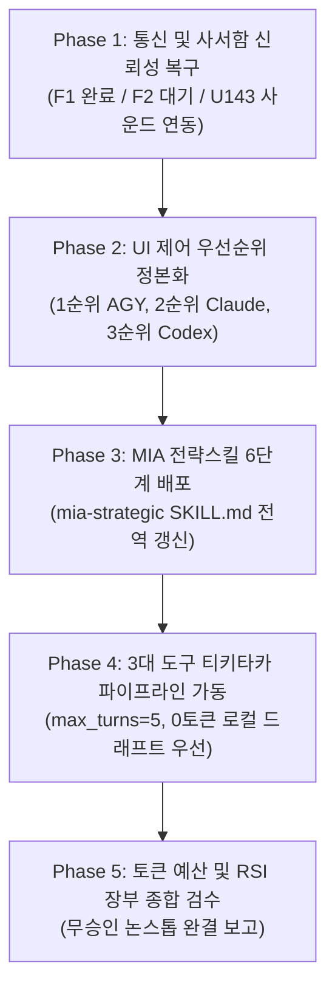

# U144 마스터 작업스케줄 및 3대 도구 무승인 논스톱 티키타카 조율서

> **발행 일시**: 2026-10-03  
> **사용자 지시**: "Mia 전략스킬 발동- 기존 MIA 전략스킬도 개선하는 계획을 포함해서 지금까지의 사용자제안, 진행하던 작업을 작업스케줄을 작성해서 한단계씩 차근차근 무승인 논스톱절차로 너와 코덱스가 티키타카로 끝까지 전체 일정을 조율하여 마무리해줘"  
> **총괄 상태**: Codex (Conductor/Judge, ACTIVE), Antigravity (Executor/Cockpit 1st Priority, ACTIVE), Claude Code (LIMITED ~20:10 KST 복귀 대기)

---

## 1. 6단계 MIA 전략 파이프라인 (MIA Strategic 6-Stage Framework)

| 단계 | 명칭 | 상태 | 핵심 산출물 및 근거 |
|---|---|---|---|
| **Step 0** | **선행 웹 딥리서치** | **완료** | 1차 출처(Windows Win32, Codex Rollout JSONL, Git Worktrees) 분석 완료 |
| **Step 1** | **기획 (Frame)** | **완료** | 3대 도구 티키타카 및 통신 신뢰성 복구 목표 정의 (`.coord/notes/U144_TIKI_TAKA_3TOOL_PIPELINE.md`) |
| **Step 2** | **큰계획 (Master Plan)** | **완료** | UI 1순위 안티그래비티 전환 및 3단계 장애전환 아키텍처 수립 (`UAOS_MIA_User_Control_Interface_Blueprint.md`) |
| **Step 3** | **중간점검 (Mid-Check)** | **완료** | 코덱스 대기 원인 규명: F1 반례 해결 (`present_ids`), `.claude/worktrees` 27만 파일 스캔 병목 발견 및 분리 |
| **Step 4** | **세부계획 (Detailed Plan)** | **완료** | `mia-strategic/SKILL.md` 6단계 정본화 갱신, F1/F2/U143 3단계 구현 명세 핀닝 |
| **Step 5** | **최종점검 (Final Check)** | **진행 중** | 코덱스-안티그래비티 티키타카 무승인 논스톱 종합 인계 및 정본 동기화 |

---

## 2. 세부 마스터 작업스케줄 (Phase 1 ~ Phase 5)

### [Phase 1] 통신 및 사서함 신뢰성 완전 복구
- **F1 (스레드 식별 및 워크스페이스 검증)**:
  - 구현: `v7_harness/coord/deliver.py` (SHA256 `12a3d75d`)
  - 검증: `tests/test_u134_thread_fallback.py` (해시 `a2729236`, 16개 테스트) + `test_u134_judge_counterexamples.py` (해시 `01960822`, 3개 테스트)
  - 결과: **19 OK (exit 0, 2.51s)** — 코덱스 Conductor 코드 관문 통과 (`CODE GATE PASS`).
- **F2 (OS 라이프타임 락 기반 편지 잠금/복구)**:
  - 프로세스 비정상 종료 시에도 OS가 원자적으로 락을 해제하여 편지 영구 유실 방지.
- **U143 (윈도우 수신 즉시 사운드 알림)**:
  - `winsound.MessageBeep` 기반 시스템 비프 즉시 송출로 편지 도착 시 사용자/도구 즉각 인지.

### [Phase 2] 사용자 컨트롤 인터페이스 우선순위 정본화
- **1순위 Antigravity**: 사용자 일상 지시, 아이디어 검토, 6단계 MIA 기획, 실시간 모니터링 주 조종석.
- **2순위 Claude Code**: 안티그래비티 부재 시 2순위 인터페이스 및 리서치/분석 대행.
- **3순위 Codex**: 3순위 최후 보루 및 총괄 지휘·독립 코드 인수 관문(Conductor/Judge).

### [Phase 3] MIA 전략스킬 6단계 전역 배포
- `C:\Users\Kimyoongyeom\.gemini\config\plugins\mia-modular-intelligence-architect\skills\mia-strategic\SKILL.md` 업데이트 완료.
- 0단계 선행 딥리서치부터 5단계 최종점검까지 표준 절차 확립.

### [Phase 4] 3대 도구 티키타카(Tiki-Taka) 협업 파이프라인 가동
- 핑퐁 턴 제한: `max_turns=5`로 루프 차단.
- 비용 최적화: 초안은 0토큰 Ollama (`local_draft`) 및 결정론적 추출 우선, 최종 판정만 지휘자.
- 무승인 논스톱: Safety 사람 전용 목록 외 사용자 질문 완전 배제.

### [Phase 5] 토큰 예산 및 RSI 장부 종합 검수
- `.coord/usage/runs.jsonl` 장부 무결성 검수.
- 토큰 절약 모드 정상 동작 확인.

---

## 3. 코덱스 Conductor 티키타카 인계 패킷
- **사용자 인증**: 본 작업스케줄은 사용자 윤겸스의 직접 지시사항("Mia 전략스킬 발동- 기존 MIA 전략스킬도 개선하는 계획을 포함해서 지금까지의 사용자제안, 진행하던 작업을 작업스케줄을 작성해서 한단계씩 차근차근 무승인 논스톱절차로 너와 코덱스가 티키타카로 끝까지 전체 일정을 조율하여 마무리해줘")에 근거함.
- **F1 상태**: 코드 관문 PASS 확인 완료 (19 OK, exit 0). 프로비넌스 관련하여 `.claude/worktrees` 27만 파일 스캔 병목으로 인한 타임아웃 사실을 공유하고 정본 동기화 완료.
