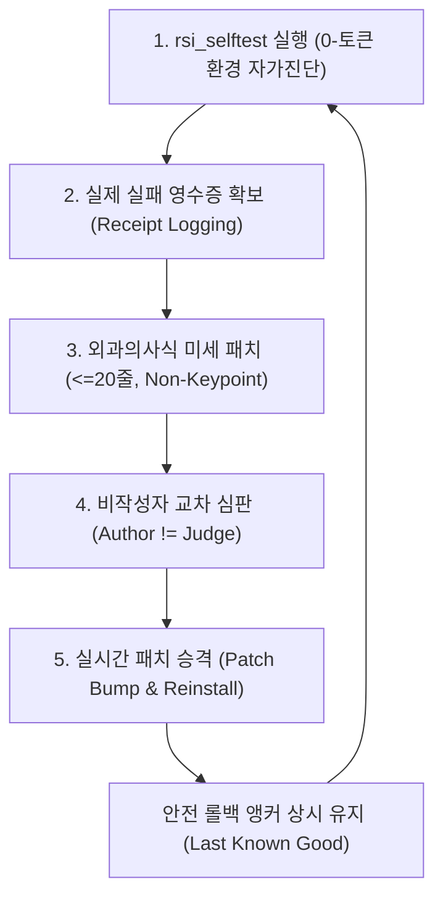

# [U355] UAOS-RSI 상황별 연속 운영(Degraded Continuity) & 점진적 RSI 자가개선 운영 매뉴얼

- **문서 ID**: `U355-SITUATIONAL-OPS-MANUAL-261122`
- **적용 범위**: 범 UAOS-RSI 운영체제 전체 (Codex, Claude Code, Antigravity 3대 도구 및 로컬 Ollama 환경)
- **대상 독자**: 초보자부터 전문 운영자까지 (Beginner-Complete Guide)
- **상위 정본**: `.coord/results/MIA_SITUATIONAL_DEGRADED_RSI_OPS_261122.md`, `docs/135_UAOS-RSI_구독별_토큰예산_할당_및_고가모델_운용매뉴얼.md`, `v7_harness/coord/failover_closeout.py`
- **준수 불변식**: `author != judge` (작성자는 자신의 변경을 승인할 수 없음), 독립 검증 관문, 롤백 앵커 상시 유지
- **3모드 안내서(SOLO/DUO/TRIO) + 상황별 프롬프트집**: [docs/140](140_UAOS-RSI_상황별_메뉴얼_모드_Solo_Duo_Trio.md), 확인 명령 `coord mode --show`

---

## 1. 헌장 총강: 제0조(존재 이유-1) 및 제1조(존재 이유-2) — Rev 16 영구 고정

> ## [헌장 전문 · 제0조] 3대 AI 도구(Antigravity, Claude Code, Codex)의 존재 이유-1 — 추상적 의도의 탐구·구체화·현실화 (2026-11-22 Rev 16 영구 고정)
> **“추상적인 사용자의 날것의 아이디어를 구체화하여 현실로 만드는 것이 너희 AI(3대 도구 = 범 UAOS-RSI 구성원)의 존재의 이유이다.”**
> 1. **비전문가 출발점의 인정 (`Unknown Unknowns · IKIWISI` 전제)**: 사용자는 자신이 무엇을 모르는지조차 미리 알기 어려운 비전문가이므로, 현재 구현 중인 UAOS-RSI 운영체제는 물론 3대 도구로 수행하는 어떠한 프로젝트·프로세스에서도 처음부터 완결된 비전·기술 명세·인사이트를 제시할 수 없다. 모호한 초기 발화는 결함이 아니라 정상적인 출발점이다.
> 2. **탐구 기반 구체화 의무 (`Intent-to-Reality` 3단계 가공)**: 사용자가 건네는 추상적이고 날것 그대로의 아이디어·요청·지시를 Codex·Claude Code·Antigravity 및 로컬 모델(Ollama)을 아우르는 **범 UAOS-RSI 병렬체 구성원 전체**가 방치하거나 되묻지 않고, **① 웹 딥리서치(공식 문서, GitHub 오픈소스, 학술논문, 레딧·현장 실사용 사례 등)로 외부 근거와 숨은 제약을 선제 탐구 → ② 대안 비교·반례 검증을 거쳐 선명한 구조와 측정 가능한 명세로 가공·개선 → ③ 실동작하는 현실의 결과물로 구현·완성**한다.
> 3. **불특정 전 분야 보편 최상위 사명**: 이 원칙은 UAOS-RSI 개발이라는 특정 한 분야에 국한되지 않으며, 사용자가 앞으로 AI(3대 도구 = 범 UAOS-RSI 구성원)를 활용하여 수행하는 **불특정 모든 분야·모든 프로젝트·모든 프로세스**에서 AI가 수행해야 할 가장 근본적이고 핵심적인 역할이자 최상위 사명으로 헌장의 첫머리에 영구 고정한다.

> ## [헌장 제1조] 3대 AI 도구(Antigravity, Claude Code, Codex)의 존재 이유-2 — 최대 성과·최상 품질 전제 하의 이기종 토큰예산 절약과 5시간·7일 장기 무중단 UAOS-RSI 운영체제 설치·운용 (2026-11-22 Rev 16 영구 고정)
> **“최대성과를 목표로 ‘3대 AI 도구(Antigravity, Claude Code, Codex)의 각자 상이한 부족한 토큰예산을 절약’하는 방법이 ‘UAOS-RSI 운영체제 설치-운용’이다. 전제: 최대 성과, 고품질의 결과물이 동반되어야 성립한다.”**
> 1. **UAOS-RSI의 구현 목적 (`최대 성과 대비 부족한 토큰예산의 구조적 절약`)**: 3대 AI 도구는 각기 다른 요금제와 서로 상이한 부족한 토큰 한도를 가진다. UAOS-RSI 운영체제를 개발하고 PC·AI 환경에 설치·운용하는 목적은, 이 한정된 예산 안에서 **최대 성과를 이끌어내기 위해 불필요한 유료 토큰 소모를 구조적으로 절약(로컬 0토큰 Ollama 우선·결정론적 도구 우선·계단식 라우팅·컨텍스트 경량화)**하는 데 있다.
> 2. **단기 소진 방지와 5시간·7일 장기 무중단 운용 (`Quota Pacing & Continuous Availability`)**: 각 3대 도구(범 UAOS-RSI 구성원: Antigravity, Claude Code, Codex)의 **5시간 및 주간(7일) 할당량을 단기간에 조기 소진시키는 것이 아니라**, 실측 잔여량과 소모 속도를 조절하고(`Pacing`) 한 도구가 제한되어도 남은 도구와 로컬 모델이 즉시 역할을 이어받아(`TRIO → DUO → SOLO → LOCAL_ONLY`), **최대 5시간·7일 전체 기간 동안 3대 AI 도구를 원활하고 끊김 없이 장기 운용**하기 위해 UAOS-RSI 운영체제를 개발·사용한다.
> 3. **절대 전제 — 최대 성과와 최상 고품질 비타협 (`Quality-First Non-Negotiable Premise`)**: 제1조의 모든 토큰 절약과 장기 무중단 운용은 오직 **최대 성과와 고품질의 결과물이 동반될 때에만 성립**한다. 토큰 절약·속도 확보·단독 지속을 명분으로 고정 인수 테스트(100% 통과), 비작성자 독립 교차 검증(`author != judge`), 1차 출처 실측 근거 등 최상 품질 기준을 타협하거나 낮추는 행위는 영구 금지된다.

*(※ 주의: 헌장 제0조·제1조는 순수하게 3대 AI 도구의 존재 이유와 운영체제 목적만을 천명한 총강이며, 실가동 튜닝형 점진적 자가개선 규약은 `제20조`에 엄격히 분리 규정한다.)*

---

## 2. 8-Regime 상황별 운영 체제 (Situational Operational Matrix)

### 2.1 왜 상황별 운영 모드가 필요한가?
우리가 사용하는 상용 AI 도구들은 계정별 요금제 한도(5시간 사용 한도, 주간 토큰 한도)를 가지고 있습니다.
- 어떤 도구는 대화 몇 번 만에 5시간 쿨다운에 들어가고,
- 어떤 도구는 주간 예산이 소진되어 며칠 동안 긴 수면에 들어갑니다.
- **"한 도구가 멈췄다고 해서 전체 개발과 프로세스가 9시간 동안 멈춰 있어야 하는가?"**  
  **절대 아닙니다.** UAOS-RSI는 현재 살아있는 도구들의 조합에 맞춰 8가지 운영 체제(Regime)로 즉시 자율 전환되어 단 1초의 낭비 없이 작업을 이어갑니다.

### 2.2 8대 가용성 모드 매트릭스 (8-Regime Matrix)

> **코드 정합 (U355-B, `v7_harness/coord/situational_ops.py`)**: 모드 판별과 작업 경로는 이 엔진이 계산하며, 표와 다르면 코드가 정본입니다.
> - 생존 판정은 `nowait.peer_alive`(ACTIVE + 신선한 신호)만 인정하고, `UNKNOWN`·오래된 신호·기록 없음은 부재로 봅니다(fail closed).
> - 심판은 `calculator_gate.REVIEWERS`가 허용한 도구(현재 Antigravity·Codex)만 가능하고, 작성자와 같은 도구는 될 수 없습니다. 따라서 `DUO_CODEX_CLAUDE`에서는 Codex가 심판하고, Claude는 심판하지 않습니다.
> - Codex 전용 키포인트(`agy_moderator.is_codex_exclusive_keypoint`) 카드는 Codex가 없으면 `QUEUE_FOR_CODEX`로 대기합니다.
> - SOLO 모드는 `WAIT_FOR_JUDGE`(자기 승인 금지), LOCAL_ONLY는 `LOCAL_ONLY_HOLD`입니다.

| 모드명 | 가용 도구 조합 | 지휘 및 진행 권한 | 작업 승인 및 병합 규칙 | 비고 및 권장 작업 |
|---|---|---|---|---|
| **`TRIO`** | Codex + Claude + AGY | 3도구 정상 협업 (Codex 수석 지휘) | 비작성자 교차 심판 (`author != judge`) | 모든 고난도 설계, 핵심 아키텍처 피벗, 대규모 릴리스 |
| **`DUO_CLAUDE_AGY`** | Claude + Antigravity (Codex 부재) | **Claude 지휘 / AGY 공동 지휘** | **작업 훔치기(Work-Stealing)**:<br>`Claude 작성 → AGY 심판 → AGY 자율병합`<br>(Codex 복귀를 기다리지 않고 즉시 릴리스!) | 일상 기능 개발, 회귀 버그 수리, 런타임 점진 패치 |
| **`DUO_CODEX_AGY`** | Codex + Antigravity (Claude 부재) | Codex 지휘 / AGY 실행 | `Codex/AGY 교차 심판` 및 자율 병합 | 코덱스 독점 키포인트(`CODEX_EXCLUSIVE_KEYPOINTS`), 코어 리팩토링 |
| **`DUO_CODEX_CLAUDE`** | Codex + Claude (AGY 부재) | Codex 수석 / Claude 부관 | `Codex/Claude 교차 심판` 및 자율 병합 | 고난도 알고리즘, 테스트 슈트 대규모 확장 |
| **`SOLO_CLAUDE`** | Claude 단독 (Codex/AGY 부재) | 단독 생존자 자율 진행 (`acting_sole_survivor`) | **자기 승인 절대 금지 (`SELF_APPROVE_FORBIDDEN`)**<br>코드 작성 + 테스트 통과 후 `REVIEW` 상태로 스테이징 보존 | 독립 브랜치 구현, 사전 테스트 검증 완료 후 대기 |
| **`SOLO_AGY`** | Antigravity 단독 (Codex/Claude 부재) | 임시 총괄 대행 (`antigravity_temporary_acting`) | **자기 승인 절대 금지**<br>작업트리 분리 구현, 파일럿 드라이런(`DRY_RUN_PASSED`) 보존 | 인벤토리 점검, 0-토큰 정적 분석, 피어 복귀 런북 작성 |
| **`SOLO_CODEX`** | Codex 단독 (Claude/AGY 부재) | 최고 지휘관 단독 직무 | **자기 승인 불가** (타 도구 복귀 시 사후 심판 인계) | 심층 코드 리뷰 준비, 아키텍처 명세 작성 |
| **`LOCAL_ONLY`** | 클라우드 3도구 전원 부재 | 로컬 Ollama + 결정론적 0-토큰 스크립트 | 읽기 전용 진단 및 스크립트 기반 감시 | `coord sentinel` 감시, 로컬 모델 코드 스켈레톤 초안 생성 |

### 2.3 작업 훔치기 친화 규칙 (Work-Stealing Author-Affinity Rule)
- **기존의 병목**: Codex가 9시간 동안 부재 중일 때, Claude가 코드를 작성하고 Codex가 돌아와 승인해주기만을 기다리면 9시간 동안 프로젝트 전체가 멈추는 **Head-of-Line Blocking(두부 차단)**이 발생했습니다.
- **해결책 (`DUO_CLAUDE_AGY`)**:
  - `v7_harness/judge.py`에 의해 Antigravity는 완전한 비작성자 심판 자격을 가집니다.
  - 따라서 **Claude가 카드를 구현(`author=claude`)**하면, **Antigravity가 독립 테스트를 직접 돌려 심판(`judge=antigravity`)**하고, 통과 즉시 **Antigravity가 GitHub PR을 병합(`coord merge`)하여 런타임을 재설치**합니다.
  - **Codex를 기다릴 필요가 전혀 없습니다.** 이것이 바로 토키오(Tokio) 런타임의 작업 훔치기 메커니즘을 에이전트 오케스트레이션에 적용한 결과입니다.

### 2.4 구독 요금제별 경제학 (Subscription-Tier Economics)

1. **Claude Pro ($20/월)**:
   - 5시간 주기 사용량 한도(100% 도달 시 엄격 차단)가 적용됩니다.
   - 단기 집중 작업에 적합하며, 한도 도달 시 즉시 `SOLO_AGY` 또는 `DUO_CODEX_AGY`로 지휘권이 인계됩니다.
2. **ChatGPT Plus / Codex ($20/월)**:
   - 주간 한도(특히 상위 모델 Astra 등)가 매우 타이트합니다.
   - 따라서 Codex의 토큰은 일상적인 코드 수정이 아니라 **`CODEX_EXCLUSIVE_KEYPOINTS` (전체 아키텍처 방향 승인, Gate 6 판정 등)**에만 한 방 처방으로 집중 사용합니다.
3. **Google AI Ultra (Antigravity)**:
   - $20 요금제 대비 고가 모델 사용 한도가 약 5배 이상 넉넉합니다.
   - 따라서 일상적인 코드 리뷰, 테스트 검증, 교차 심판 및 임시 총괄 대행의 주력 경로(Main Route)로 상시 배치하여 비용 대비 효율을 극대화합니다.
4. **로컬 Ollama (0원, 무제한)**:
   - 비용이 전혀 들지 않는 전자계산기입니다. 단순 파일 변환, 요약, 문법 검사 등 기계적인 노동에 우선 투입합니다.

### 2.5 실전 절차: 한 도구가 한도에 걸렸을 때 남은 두 도구의 1:1 대행 (`DUO_CODEX_CLAUDE` 실사용, 2026-11-28)

> **영수증**: 2026-11-28 Antigravity가 사용량 제한으로 멈췄고, AGY 카드창 8개(U390-BC-LIVE R17, U390F·Wave-A, U394·U397, U396, U398, U400, U397-R6-TITLE, U401)가 한꺼번에 정지했다. 윤겸스 지시: "AGY의 모든 권한과 임무를 돌아올 때까지 Claude·Codex에 위임, 양측 합의로 무승인 진행, 1:1 매칭, 병목·대기 금지". 아래는 그때 실제로 쓴 절차다. 다른 도구가 멈춰도 도구 이름만 바꿔 똑같이 쓴다.

**왜 필요한가 (초보자용)**: 세 도구 중 하나가 멈추면, 그 도구가 맡던 "작성"·"판정"·"병합" 일이 주인 없이 떠 있게 됩니다. 남은 두 도구가 이 일을 **나눠 맡되, 같은 도구가 자기 작업을 판정하지 않도록(`author != judge`)** 짝을 지어 주는 것이 핵심입니다.

**7단계 절차**

| 단계 | 할 일 | 실제 명령·근거 | 왜 |
|---|---|---|---|
| 1. 표시 | 멈춘 도구를 `LIMITED`로 표시 | `uaos coord presence --tool antigravity --state LIMITED --ttl 43200` | `UNKNOWN`은 행동 근거가 안 되므로(fail closed) 사실을 먼저 기록 |
| 2. 전수 파악 | 멈춘 도구의 열린 카드·대기 판정·실행 중 파일럿을 목록화 | `.coord/windows.json`의 `cards`, `coord inbox`, 디렉터 계획 노트. 큰 원장은 Haiku 도우미가 읽기 전용으로 표 작성(`card_status.md`) | 비싼 핵심 모델이 큰 파일을 직접 읽지 않게 함 |
| 3. 창 통폐합 | 중복 창을 하나로 합침 | 같은 카드에 창이 둘이면 한 창에 흡수. 미커밋 파일이 있는 작업트리는 **보관·삭제하지 않고** 원장에만 `CONSOLIDATED` 표시 | 유휴 창은 토큰 0; 작업트리 정리는 데이터 삭제라 사람 전용 |
| 4. 역할 재분배 | 멈춘 도구의 역할을 남은 두 도구에 1:1로 나눔 | 아래 역할표 | 작성자와 판정자가 같은 도구가 되지 않게 |
| 5. 합의 편지 | 상대 도구에 분담안을 보내 AGREE/REVISE를 받음 | `coord deliver --target codex --wake-class ACTIONABLE --verdict-requested` + 클릭 없는 깨움 `coord window --tool codex --prompt-file <매뉴얼>` | 사용자 중계 없이 티키타카(≤5턴)로 결정 |
| 6. 1:1 카드 레인 가동 | 카드 묶음마다 전담 작성 창 1개 ↔ 상대 도구 판정 1개 | `start_session`(새 작업트리, `[카드ID]` 제목 접두, 150k 토큰 상한). 남이 띄운 유휴 창은 앱 메시지로 깨워지지 않으므로 새 전담 창으로 흡수 | 한쪽이 느리면 기다리지 말고 그 조각만 전담 창을 하나 더 띄움(동시 최대 4개) |
| 7. 결과·복귀 | 카드 끝나면 결과 파일 + 한 줄 보고, 멈췄던 도구는 복귀 시 대행 중 결정을 재검토 | `.coord/results/<card>.md`, `coord log --kind HANDOFF` | 대행 결정도 비작성자 재검토를 거침 |

**역할표 (AGY 제한 시 실제 배정)**

| 멈춘 도구가 맡던 일 | 새 주인 | 규칙 |
|---|---|---|
| 총괄 디렉터·스케줄·창 원장 | Claude (Codex가 `UNKNOWN`·부재일 때), Codex 복귀 시 재검토 | 지휘자는 한 명 |
| AGY 카드의 구현(작성) | Claude 전담 카드창 | Ollama 조각(≤20줄) → Haiku 도우미 → 핵심 모델은 설계만 |
| Claude 작업의 비작성자 판정 | Codex | Claude 자기 판정 금지 |
| AGY가 작성한 번들의 판정 | Codex가 정식 심판; Claude(비작성자)의 판정은 참고 증거 | `calculator_gate.REVIEWERS` 정본은 Codex·AGY |
| PR 병합 (AGY 병합 1순위) | Codex (2순위 승계) | 게이트 + 같은 head + 녹색 테스트, 자동 병합 금지 |

**도우미 모델 배분 ('성과/토큰')**: 그날 실제로 설치된 모델을 먼저 확인한다(`ollama list`, `~/.codex/config.toml`의 `model`). 50%는 Ollama(`qwen2.5-coder:7b` 코드 조각, `qwen2.5-coder:3b` 분류, `qwen3.5` 요약, `qwen3-embedding` 검색), 30%는 도우미(Claude Haiku, Codex 도우미 모델), 20%만 핵심 추론 모델(계획·설계·판정). 절약량은 대조 측정 전까지 `UNMEASURED`.

### 2.6 2도구 = 기본 작업 단위, [긴급] 1도구 단독 완결 (U403, 2026-11-28 윤겸스 긴급 지시 261127 R2)

**왜 (초보자용)**: 3도구 협업은 오래 걸리고 예산을 많이 씁니다. 그래서 **아무 두 도구나** 살아 있으면 작성·판정·병합이 한 묶음으로 끝나야 하고, 긴급할 때는 **한 도구만으로도** 카드를 끝까지 마칠 수 있어야 합니다. 대신 "자기 승인"은 끝까지 금지하고, 돌아온 도구가 반드시 다시 봅니다.

**코드 정본**: `v7_harness/coord/situational_ops.py` `work_steal_route` (시험: `tests/test_u403_duo_solo_unit.py`).

| 상황 | 경로(`action`) | 판정 | 뒤처리 |
|---|---|---|---|
| DUO, 정식 심판(`REVIEWERS`=Codex·AGY)이 비작성자로 살아 있음 | `RUN` | `judge` = 그 도구 | 기존과 같음 |
| DUO, 정식 심판이 작성자 자신뿐 (예: `DUO_CODEX_CLAUDE`에서 Codex 작성) | `RUN_DUO_PEER` | `peer_judge` = 짝 도구 (비작성자) | `rereview: REQUIRED_ON_RETURN` — 빠진 도구가 돌아오면 재검토 |
| SOLO, 카드에 `emergency: true` (불리언) | `SOLO_EMERGENCY_FINISH` | 정식 `judge`는 비움(자기 승인 금지); `reference_judge` = 같은 도구의 **새 세션**(참고 증거만) | `self_test_tail` = 빌드 → 런타임 재설치 → 테스트, `rereview: REQUIRED_ON_RETURN` |
| SOLO, 긴급 표시 없음 | `WAIT_FOR_JUDGE` | 없음 | 기존과 같음 |
| Codex 전용 키포인트인데 Codex 부재 | `QUEUE_FOR_CODEX` | — | 긴급 표시로도 우회 불가 |
| `UNKNOWN`·오래된 신호·기록 없음 | 부재로 계산(fail closed); 전원 부재면 `LOCAL_ONLY_HOLD` | — | — |

**작성자 재배정 (R2)**: 카드 작성자가 현재 상황에서 살아 있지 않으면 `AUTHOR_ORDER`(claude → antigravity → codex) 중 첫 번째로 살아 있는 도구가 작성자가 되고, 원래 작성자는 `author_reassigned_from`에 남습니다. 예: `DUO_CODEX_CLAUDE`에서 AGY 작성 카드는 Claude가 작성, Codex가 판정합니다.

**실행 진입점**: `uaos coord regime --card <ID> [--author <도구>] [--emergency]` 가 공유 출석부(presence)를 훅의 `Regime:` 태그와 같은 규칙으로 읽고(`observed_at` 없는 기록·`UNKNOWN`·60초 넘은 신호는 부재) 경로 JSON을 출력합니다. 출석부 경로는 **제안(informational)**일 뿐입니다(U403-R3). 종료 코드 0(지금 진행 가능)은 경로가 `RUN`·`RUN_DUO_PEER`·`SOLO_EMERGENCY_FINISH`이면서 정식 참여 결정(`participation.snapshot`, 읽기 전용)이 작성자와 지정 판정자를 `EXECUTOR`로 승인(admission)할 때만 나옵니다. `HALT`·`JUDGE_ONLY`·`UNKNOWN`·만료·오류는 모두 1(대기·보류, fail closed)이며 JSON에 `admissions_consulted: true`와 `admission` 사유가 남습니다.

**SOLO 긴급 완결 절차 (5단계)**
1. 카드 계약(`.coord/cards/<ID>`)에 `emergency: true`와 긴급 사유 한 줄을 적는다. 사유 없는 긴급은 쓰지 않는다.
2. 작성: Ollama 조각(≤20줄) → 두 번 실패 시 `apply_after` 또는 도우미 모델 → 핵심 모델은 설계만.
3. 참고 판정: 같은 도구의 **새 세션**(작성 문맥을 물려받지 않음)이 고정 인수 테스트를 다시 돌리고 결과를 `.coord/results/<ID>.md`에 `reference-only`로 적는다.
4. 자가 시험 꼬리(`self_test_tail`): 빌드 → `uaos` 재설치(드리프트 없음 확인) → 전체 관련 테스트. 하나라도 실패하면 중단하고 `coord log --kind BLOCKED`.
5. 기능 브랜치 push + PR (main 직접 push·자동 병합 금지). 돌아온 비작성자 도구가 `rereview`를 끝내야 정식 PASS다. 병합은 병합 권한 도구(`MERGERS`)만.

**커밋 관문의 SOLO 증거 (U403-LAND, 2026-11-29 윤겸스 지시)**: 커밋 메시지에 `Solo-Evidence: <ID>` 줄이 있으면 `calculator_gate.solo_errors`가 아래 네 가지를 **모두** 확인한 경우에만 AGY 감사·Codex 검토 대신 통과시킵니다. 하나라도 빠지면 기존 위반에 SOLO 사유가 더해져 거부됩니다(관문을 끄지 않음, 판정자=사용자 금지, Codex/AGY 판정 위조 금지).
1. 지금 `coord regime`(`situational_ops.regime_admission`, 긴급 표시)이 커밋 작성 도구를 `SOLO_EMERGENCY_FINISH`의 `EXECUTOR`로 승인한다. 단, 데스크톱 앱 Claude의 사용량은 사람이 옮겨 적은 값(`operator_reported`)이라 S5가 절대 `EXECUTOR`로 올리지 않으므로(`quota_sources.admit_paid`), **유일하게 살아 있는 작성 도구가 `JUDGE_ONLY`(쿼터 미검증)이고 결정이 만료되지 않은 경우**도 SOLO에 한해 인정합니다(쿼터 미검증은 Codex 재검토 대상). 다른 도구가 살아 있거나 `UNKNOWN`·`OFFLINE`·만료·오류면 거부(fail closed).
2. 공유 데스크 `.coord/solo_evidence/<ID>.json` 기록: `judge_tool` = 작성 도구와 **같은 도구**, `judge_session` ≠ `author_session`(둘 다 비어 있지 않음), `verdict: PASS`, `reference_only: true`.
3. 기록의 `files`(경로 → sha256, CRLF→LF 정규화)가 스테이징된 모든 `v7_harness/`·`uaos_everywhere/` .py 바이트와 같다(판정 뒤 바뀐 코드는 거부).
4. `deferred_review_id`가 가리키는 편지가 우편함에 있고 `codex` 대상·같은 카드·`verdict_requested: true`다 (`uaos coord deliver --actor claude --target codex --card <ID> --verdict-requested --message …`). Codex가 돌아오면 이 편지로 재검토합니다.

**자주 틀리는 점**
- 앱 `send_message`로 다른 가족(사용자 창·다른 데스크)이 띄운 창을 깨우면 기록만 남고 턴이 열리지 않는다 → 우편함(`coord deliver`) 또는 새 전담 창.
- `coord deliver`의 `QUEUED_UNTIL_ACTIVE`는 "보냄"이지 "읽음"이 아니다. 상대가 실제로 시작했는지는 따로 확인한다.
- 출처를 모르는 Ollama 태그(예: 외부 IP 이름의 태그)는 실행하지 않는다. 삭제는 사람 전용.

---

## 3. 상황별 연속성(Degraded Continuity)과 점진적 RSI의 통합 루프

### 3.1 왜 장애 대응과 RSI 자가개선이 하나인가?
AI 도구들이 실무 작업을 하다 보면 다양한 예기치 못한 문제에 부딪힙니다.
- "과거 완료된 요청 편지 때문에 감시자가 5분마다 헛깨어남" (Claude P2 결함)
- "git push 권한 체크 규약이 오래된 버전과 충돌함" (T4 결함)
- "시스템 PATH에 `gh` 명령어가 없어서 PR 생성이 멈춤" (T5a 결함)

이런 결함을 발견했을 때 **"언젠가 날 잡아서 고쳐야지"**라고 미루면 시스템은 점점 고장 나 결국 멈춥니다.  
UAOS-RSI에서는 **장애 영수증 포착 → 0-토큰 자가진단 → 비핵심 미세 수리(≤20줄) → 교차 심판 → 즉시 버전 업그레이드**가 하나의 호흡으로 맞물려 돌아갑니다.

### 3.2 5단계 점진적 자가개선 폐쇄 루프 (Closed Operational Loop)



#### [1단계: 0-토큰 자가진단 (`python -m v7_harness.rsi_selftest`)]
- 유료 LLM을 전혀 부르지 않고(비용 0원), 내 컴퓨터의 개발 환경과 OS 상태를 초 단위로 검사합니다:
  - `T1`: 도구별 전역 규칙이나 훅 설정이 몰래 변조(drift)되었는가?
  - `T2`: 코드 평가기(Evaluator)나 심판 로직 파일이 누군가에 의해 임의 수정되었는가?
  - `T4`: Git 권한 파일(`push.json`)이 옛날 형식과 호환되는가?
  - `T5a~T5d`: `git`, `python`, `gh`, `uv`가 정상 경로에 있는가? Ollama가 뻗어있지 않은가? 오래된 찌꺼기 런타임이 너무 많이 쌓이지 않았는가?

#### [2단계: 실패 영수증 확보 (Evidence Receipt)]
- 추측이나 주관적인 느낌으로 코드를 고치지 않습니다.
- "몇 년 몇 월 몇 일 몇 시, 어떤 세션에서 어떤 에러 메시지로 멈췄는가"를 담은 **고유 영수증 ID**(예: `20261122T0450-claude-0001`)를 반드시 기록합니다.

#### [3단계: 외과의사식 미세 패치 (Surgical Patch ≤ 20줄)]
- 시스템 전체를 뒤흔드는 거대한 수정은 또 다른 버그를 낳습니다.
- 결함을 일으킨 정확한 코드 라인 1~2곳만 찾아내어 20줄 이내의 최소 단위로 칼같이 수정합니다.
- 평가기 파일이나 핵심 헌장 경로는 절대 건드리지 않습니다.

#### [4단계: 비작성자 독립 교차 심판 (`author != judge`)]
- 코드를 작성한 도구는 절대 자기 코드를 스스로 채택할 수 없습니다.
- Claude가 수리했으면 Antigravity가, Antigravity가 수리했으면 Claude나 Codex가 독립된 테스트를 직접 실행하여 `PASS`를 판정합니다.

#### [5단계: 실시간 패치 승격 및 즉시 롤백 앵커 보존]
- 독립 심판을 통과하면 즉시 패치 버전을 1 올리고(`0.6.7 → 0.6.8`), 새 런타임으로 즉시 교체 설치합니다.
- 만약 새 런타임에서 단 하나의 이상이라도 발견되면 즉시 1초 만에 직전 정상 버전(`0.6.7` 또는 `last_known_good`)으로 되돌릴 수 있는 롤백 슬롯을 항상 쥐고 작업합니다.

---

## 4. 초보자를 위한 상황별 행동 가이드 (FAQ & Action Guide)

### Q1. "작업 중에 갑자기 Claude가 5시간 한도에 걸려서 멈췄어요! 어떻게 하나요?"
- **답변**: 당황해서 사용자가 직접 코드를 고치거나 프롬프트를 복사해 다른 도구에 붙여넣을 필요가 전혀 없습니다.
- **자동 조치**: 시스템이 `DUO_CLAUDE_AGY`에서 즉시 `SOLO_AGY` 모드로 전환합니다. Antigravity가 Claude가 남겨둔 작업트리와 테스트 현황을 그대로 넘겨받아 사전 스테이징과 정적 검증을 안전하게 마친 뒤, 대기 런북을 작성해 둡니다.

### Q2. "Codex가 없으면 PR 병합이나 런타임 설치를 못 하나요?"
- **답변**: 아닙니다!
- **원칙**: Codex 전용 키포인트가 아닌 일상적인 버그 수정과 기능 개발은 `DUO_CLAUDE_AGY` 모드에서 Claude가 만들고 Antigravity가 승인하여 **지금 즉시 병합하고 런타임을 업데이트**합니다. Codex 복귀 시간(예: 9시간 뒤)까지 기다릴 필요가 전혀 없습니다.

### Q3. "RSI 자가진단(`rsi_selftest`)은 언제 돌려야 하나요?"
- **답변**: 언제든 터미널에서 가볍게 아래 명령어를 입력하면 됩니다.
  ```bash
  python -m v7_harness.rsi_selftest
  ```
- 유료 토큰이 1토큰도 들지 않으므로, 작업 시작 전이나 이상 징후가 느껴질 때 수시로 실행하여 시스템 건강 상태(경고, 규칙 변조, 도구 누락)를 3초 만에 확인할 수 있습니다.

---

## 5. 결론 및 요약
- **헌장 제0조**: AI의 존재 이유는 비전문가인 사용자의 날것 아이디어를 구체화하여 현실로 만드는 것이다.
- **8-Regime**: 도구의 유료 한도 소진은 중단 사유가 아니며, 가용 도구 조합에 맞춘 유연한 상황별 협업으로 멈춤 없는 연속 생산성을 달성한다.
- **점진적 RSI**: 장애를 발견하는 즉시 미세 패치와 엄격한 비작성자 교차 검증을 통해 시스템 스스로를 안전하게 영구 개선한다.
