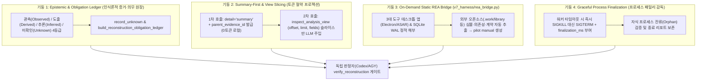

# REA (Reverse Engineer Anything) 전수분석 참조자료 및 UAOS-RSI 업그레이드 마스터 계획서

- **문서 번호**: `docs/86` (2026-10-26 정밀 전수분석·마스터 스케줄 개정본)
- **작성자**: Antigravity (`[261026-1] 메인컨트롤UX·3도구병렬` 사용자 창구)
- **협의·수신**: 윤겸스, Codex (Conductor), Claude Code (Implementer)
- **1차 출처 필수 근거 데이터 (Evidence Citation Invariant)**:
  - **뉴스 기사**: [ZDNet Korea — 만드는 법 몰라도 AI가 프로그램 재현…'REA' 뭐길래 (2026-10-19)](https://zdnet.co.kr/view/?no=20261019165618)
  - **공식 GitHub 저장소**: [GitHub — morluto/rea (Reverse Engineer Anything)](https://github.com/morluto/rea) (`HEAD` commit `1173c0a9dc1b352a60943a491462294db8f353ae`, v6.8.0, MIT License, ★383,914 / Forks 96,070)
  - **공식 문서 및 쇼케이스**: [rea.tools 공식 사이트](https://rea.tools/) · [DX-Ball 역설계 재현 저장소 (N0zoM1z0/dx-ball)](https://github.com/N0zoM1z0/dx-ball) · [TH04 역설계 재현 저장소 (N0zoM1z0/th04)](https://github.com/N0zoM1z0/th04) · [npm rea-agents 패키지](https://www.npmjs.com/package/rea-agents)

---

## Stage 0. 선행 리서치 (Web Deep Research & 1차 출처 전수 해부)

### 0.1 ZDNet Korea 기사 (`no=20261019165618`) 핵심 내용 전수 해부
1. **현상과 배경**:
   - 소스코드가 없는 완성형 소프트웨어(네이티브 실행 파일, Electron 데스크톱 앱, 모바일 APK, 웹 번들)의 내부 동작을 AI 코딩 에이전트(Claude Code, OpenAI Codex, Cursor, Gemini CLI 등)가 스스로 역추적해 재현할 수 있게 만든 오픈소스 **'REA(Reverse Engineer Anything)'**가 공개 직후 GitHub 스타 38만 개를 돌파하며 글로벌 개발 생태계의 핵심 인프라로 부상.
2. **작동 원리 (자체 디컴파일러가 아닌 AI-분석기 오케스트레이션 브리지)**:
   - REA는 바퀴를 재발명하지 않고, 기존 최고 수준의 역공학 엔진(**Ghidra, IDA Pro, Hopper, JADX, Cutter/Rizin, objdump, GDB/pwndbg, Wireshark tshark**)과 정적 파서(Electron ASAR, Babel AST, .NET CIL, Unity IL2CPP, Rust `.dep-v0`, Go buildinfo, SQLite WAL)를 **단일 MCP(Model Context Protocol) 서버 및 CLI(`rea-agents`)**로 묶어 에이전트에 노출.
3. **3단계 증거 기반 재현 워크플로우**:
   - **(1) 자연어 목표 지시**: *"Notes 앱의 검색 기능이나 특정 오디오 계산 로직이 어떻게 작동하는지 근거와 함께 찾고 우리 프로젝트용으로 구현해 줘."*
   - **(2) 정적·동적 교차 추적**: 에이전트가 REA MCP 도구를 호출해 함수 호출 그래프(`build_call_path`), 의사코드(`analyze_function`), 런타임 IPC/네트워크 캡처(`inspect_web_network_capture`)를 수집.
   - **(3) 근거(`evidence_id`)·미확인(`unknown`) 분리 및 차등 검증 재현**: 단순 추측이 아니라 **관측 사실(Observations), 도출(Derivations), 추론(Inferences), 미확인 한계(Unknowns)**를 엄격히 분리하고, 원본 바이너리와 재현 코드의 입출력을 전수 비교(`verify_reconstruction`)하여 100% 일치할 때만 완료 판정.
4. **대표 실증 사례**:
   - **DX-Ball (1996년 Windows x86 게임)**: 사운드 패닝(Position-to-Pan) 보조 함수를 역설계해 불완전한 의사코드를 현대 C 코드로 재작성하고, 원본 x86의 **3,205개 입력 케이스 전수 통과 및 컴파일된 함수 63바이트 완전 일치** 달성.
   - **Notion 데스크톱 (Electron 앱)**: 렌더러 클립보드 API에서 Preload 스크립트 및 Main 프로세스 IPC 브리지까지의 비공개 리치 포맷 처리 경로를 소스 없이 역추적.
   - **Web App → RL 에이전트 환경(`AgentEnv`) 자동 구축**: 라이브 웹앱이나 HAR 네트워크 캡처를 분석해 상태 전이 규칙이 검증된 로컬 에이전트 훈련/평가 환경(`rea environment-build`)으로 즉시 변환.
5. **시사점 및 거버넌스 경계**:
   - 바이너리·패키지 **'읽기 비용(Reading Cost)'을 사실상 0에 수렴**시켜 레거시 현대화·상호운용성 브리지 구축·자체 보안 감사를 혁신하지만, 비신뢰 바이너리 실행 위험 및 상용 코드 무단 복제 등 저작권·보안 경계를 통제할 **격리 샌드박스 및 Clean-Room 명세 변환 게이트**가 필수적임.

---

### 0.2 GitHub 공개 자료 (`morluto/rea`) 전수분석 참조자료 (Reference Dossier)

GitHub API를 통해 `morluto/rea` 최신 `main` 브랜치(`1173c0a9dc1b352a60943a491462294db8f353ae`, v6.8.0)의 전체 트리 **6,781개 엔트리(파일 6,324개, 디렉터리 457개, 총 85,771,681 Bytes / 85.77 MB)**를 전수 스캔하여 아키텍처와 핵심 모듈을 추출했습니다.

#### (1) 저장소 정량 구조 요약
| 최상위 디렉터리 | 파일 수 | 용량 (Bytes) | 핵심 역할 및 포함 모듈 |
|---|---:|---:|---|
| `src/` | 3,079 | ~41.2 MB | 도메인 시맨틱(`domain` 1,012), 애플리케이션 워크플로우(`application` 522), 브라우저(`browser` 184), 네이티브(`native` 137), MCP 서버(`server` 135), 프로세스 감독(`process` 127), 아티팩트(`artifacts` 122), **MCP 계약(`contracts` 131)**, Ghidra(`ghidra` 89), CLI(`cli` 74), .NET(`dotnet` 49), Hopper(`hopper` 38), IDA(`ida` 36), JS/Electron(`javascript` 32, `electron` 9) |
| `tests/` | 1,970 | ~24.8 MB | `domain`, `services`, `adapters`, `composition`, `conformance`, `evaluation`, `boundary`, `mcp-boundary`, `acceptance` 다층 검증 스위트 및 Stryker 변이 테스트(`stryker.semantics.config.mjs`) |
| `scripts/` | 498 | ~6.4 MB | CLI 엔트리(`rea.mjs`), Electron 활성 훅(`electron-active-hook.cjs` 1,329줄, `electron-active-hook-boundaries.cjs`), 카탈로그/증거 원장 생성기(`generate-completion-ledger.mjs`), 프로바이더별 실증 검증 스크립트(`verify-real-*.mjs`) |
| `docs/` | 278 | ~5.9 MB | MCP 계약 명세(`docs/mcp-contracts.md` 96,090 bytes), 도구 설계(`docs/tool-design.md`), 아키텍처 다이어그램(`docs/architecture.mermaid`), 23개국어 README 및 타깃별 역설계 가이드 |
| `experiments/` | 229 | ~3.1 MB | 분석 효율성(`analysis-efficiency`) 벤치마크 및 토큰/지연시간 최적화 실험 |
| `bridge/` | 35 | ~1.2 MB | 이기종 역공학 엔진 브리지: `ReaGhidraBridge.java`(247 KB), `hopper_bridge.py`(58 KB), `cutter/rea_bridge.py`(58 KB), `ReaJadxBridge.java`(36 KB), `rea_lldb_tracer.py`, `NativeUIChildren.swift`, `pwntools`/`pwndbg`/`mitmproxy` 브리지 |
| `.agents/skills/` | 16 | ~159 KB | 5대 공식 에이전트 스킬: `reverse-engineer-anything`(v49, 509줄), `rea-analysis-optimization`, `rea-ci-tests-audit`, `rea-tool-design`, `rea-changelog-update` |

#### (2) REA의 5대 핵심 설계 원칙 (`AGENTS.md` 및 `.agents/skills/` 원문 대조)
1. **단방향 내부 의존성 (Inward Dependency Flow)**:
   - `domain semantics & contracts` → `provider adapters` → `shared application workflows` → `CLI / MCP adapters` 순으로 의존성이 흐르며, 개별 디컴파일러 프로토콜이 도메인 계층을 오염시키지 않음.
2. **사실 등급 엄격 분리 (Epistemic Provenance & Unknown Ledger)**:
   - 모든 분석 결과는 **Observations(직접 관측)**, **Derivations(결정적 도출)**, **Inferences(추론 후보)**, **Unknowns(미확인 한계)**를 구분하며, 각 결과는 고유 `evidence_id`를 가짐. 미해결 질문은 `record_unknown` / `update_unknown`으로 세션 레지스트리에 명시적으로 추적하고, 빈 페이지나 부분 스캔을 "부재 증명(Proof of Absence)"으로 오판하는 것을 금지함.
3. **Summary-First & Compact Schema (에이전트 토큰 최우선 절약)**:
   - 성능 최적화 우선순위를 **① 에이전트 토큰 및 콘텍스트 → ② 분석 시간(유효성 검증된 캐시 재사용) → ③ CPU/메모리** 순으로 고정.
   - 기본 MCP 스키마는 `compact` 프로필로 노출해 도구 탐색 토큰 오버헤드를 줄이고(`REA_MCP_INPUT_SCHEMA_PROFILE=full` 선택 가능), 대용량 바이너리/JS 앱은 `detail: "summary"`로 부모 `evidence_id`만 먼저 확보한 뒤 `inspect_analysis_view`로 필요한 섹션·심볼·페이지만 슬라이싱 조회.
4. **Read-Only / Ephemeral 데이터베이스 및 프로세스 생명주기 소유권**:
   - Ghidra는 실행 파일 바이트를 수정하지 않는 임시(ephemeral) DB로만 구동하고, IDA 브리지는 읽기 전용(`read-only`)으로만 연결. 프로세스 캡처 시 단순 PID가 아니라 프로세스 패밀리 전체의 생명주기(최종 정리 중 취소, `SIGTERM` → `finalization_ms` 대기 → `SIGKILL` 단계적 종료)를 추적.
5. **유한 타입 명세 기반 재현 검증 (`verify_reconstruction` & `build_reconstruction_obligation_ledger`)**:
   - 역설계 재현 시 "전체가 비슷하다"는 모호한 주장을 거부하고, `build_reconstruction_obligation_ledger`로 검증 의무 항목을 원장화한 뒤 `verify_reconstruction`으로 유한 타입 명세(Finite Typed Specification)를 실제 오라클과 대조.

#### (3) REA 핵심 MCP 도구 카탈로그 (50개 핵심 도구 & 7대 패밀리)
| 패밀리 | 대표 MCP 도구 (`src/contracts/*`) | UAOS-RSI 연계 활용 포인트 |
|---|---|---|
| **1. JS / Electron / Web 분석** | `analyze_javascript_application`, `analyze_web_bundle`, `list_electron_targets`, `inspect_electron_fuses`, `trace_javascript_semantics`, `compare_javascript_export_shapes`, `compare_source_to_bundle` | Antigravity·Claude Desktop·Codex 데스크톱 앱(Electron/ASAR)의 내부 IPC 채널, 상태 DB, 훅 경계(`electron-active-hook.cjs`)를 소스 없이 0토큰 정적 해부 |
| **2. SQLite / 아티팩트 / 패키지** | `inspect_sqlite_database`, `inspect_artifact`, `extract_artifact`, `compare_artifacts`, `inspect_python_pyc`, `inspect_model_artifact` | 3대 도구의 로컬 상태 DB(`state.vscdb`, `conversation_summaries.db`, WAL 스냅샷)와 `.pyc` 캐시를 안전하게 정적 스키마/행 단위로 검사 |
| **3. 증거 조회·슬라이싱 뷰** | `inspect_analysis_view`, `export_evidence_bundle`, `inspect_analysis_settings`, `update_analysis_settings` | 전체 분석 산출물을 유료 LLM 콘텍스트에 붓지 않고 `parent_evidence_id` + `offset/limit/fields`로 좁은 슬라이스만 추출 (UAOS Token-Thrift 직결) |
| **4. 미확인 원장 & 재현 검증** | `record_unknown`, `update_unknown`, `list_unknowns`, `build_reconstruction_obligation_ledger`, `verify_reconstruction`, `compare_functions`, `find_changed_behavior` | UAOS-RSI의 `UNKNOWN` 규율 및 계약 매뉴얼(`pilot manual`)의 고정 인수 게이트를 **Reconstruction Obligation Ledger**로 고도화 |
| **5. 런타임·네트워크·프로세스** | `capture_process_scenario`, `capture_browser_scenario`, `inspect_web_network_capture`, `correlate_static_and_runtime` | 하위 워커(`pilot run`) 타임아웃/종료 시 `finalization_ms` 기반 우아한 종료(`SIGTERM`→`SIGKILL`) 및 정적-동적 상관 검증 |
| **6. AgentEnv 환경 빌더** | `inspect_analysis_view (kind: environment-manifest / environment-state / environment-coverage)`, `rea environment-build` | 기록된 API/도구 트레이스로부터 부작용 없는 로컬 리플레이/상태 검증 하네스를 자동 생성하여 RSI 후보 시험에 활용 |
| **7. 네이티브·모바일·펌웨어** | `open_binary`, `binary_overview`, `analyze_function`, `trace_call_path`, `trace_native_values`, `inspect_pe_imports`, `inspect_rust_binary`, `inspect_go_binary` | 외부 네이티브 도구(Rust/Go/PE 바이너리)의 내장 의존성(`.dep-v0`), 임포트 테이블, 호출 경로를 정적 검증 |

---

## Stage 1 ~ 2. 기획 및 다각화 검증 (Feasibility, Validity & Value Evaluation)

### 1.1 의사결정 정의 및 성공 신호 (Framing)
- **핵심 질문**: *"REA를 UAOS-RSI에 어떻게 도입해야 유료 토큰 소모와 보안/복잡도 위험 없이 3대 도구 오케스트레이션 역량을 실질적으로 업그레이드할 수 있는가?"*
- **측정 가능한 성공 신호 (Success Signals)**:
  1. 외부 패키지·데스크톱 앱·로컬 DB 분석 시 전체 파일 로딩 대비 **에이전트 입력 토큰 70% 이상 절감** (`detail: "summary"` + `inspect_analysis_view` 슬라이싱 패턴).
  2. 미확인 사항(`UNKNOWN`)의 수동 누락 0건 — `record_unknown` / `obligation_ledger` 스키마로 계약 매뉴얼에 자동 귀속.
  3. 3대 도구(Antigravity, Claude Code, Codex)의 로컬 런타임/DB/ASAR 경계 변경 시 0토큰 정적 감지로 호환성 깨짐을 사전 차단.
- **비목표 (Non-Goals)**:
  - 무거운 상용/네이티브 디컴파일러(IDA Pro, Hopper, 수 기가바이트 Ghidra 풀 패키지)를 UAOS 기본 런타임 필수 의존성으로 강제 설치하지 않음.
  - 비신뢰 외부 바이너리를 호스트 권한으로 직접 실행하거나 상용 소프트웨어를 무단 복제하지 않음.

### 1.2 대안 비교 및 4대 렌즈 검증 (Stage 2 Verification)

| 대안 | 설명 | 가치 (Value) | 실현성 (Feasibility) | 위험 (Risk) | 판정 |
|---|---|---|---|---|---|
| **대안 A: REA 전면 네이티브 설치** | 모든 작업창에 `rea-agents` MCP(100+ 도구) + Ghidra/Frida 상시 구동 | 높음 | 낮음 (도구 스키마가 콘텍스트 잠식, 무거운 의존성) | 높음 (`COST_EXCEEDED` 및 공격 표면 확대) | **No-Go (기각)** |
| **대안 B: UAOS-REA 하이브리드 커스텀 흡수 (권장)** | ① REA의 **아키텍처 핵심 패턴 4종**(Summary-First View, Unknown/Obligation 원장, `finalization_ms` 프로세스 감독, Compact Schema)을 `v7_harness` 코어에 직접 내재화하고, ② `rea-agents` CLI/MCP는 **격리된 온디맨드 정적 분석 어댑터(`v7_harness/rea_bridge.py`)**로만 호출 | **최고** (0토큰 절감 + 3도구 IPC/DB 정밀 분석 + 코어 경량 유지) | **최고** (Python 표준 라이브러리 + 선택적 `npx rea-agents` JSON 호출) | **낮음** (Read-Only 정적 경로 강제 + `.work/rea/` 격리) | **Go (채택)** |
| **대안 C: 단순 외부 참고자료로만 보관** | 문서만 남기고 UAOS 코드/규칙에는 미반영 | 낮음 | 높음 | 없음 | **No-Go (기각)** |

---

## Stage 3 ~ 4. 큰계획 (Macro Plan) 및 아키텍처 검증

### 3.1 UAOS-RSI × REA 커스텀 업그레이드 4대 기둥 (Macro Architecture)

### 3.2 큰계획 검증 (Stage 4 Verification)
- **Token-Thrift 정합성**: REA MCP 서버를 모든 유료 에이전트 세션에 상시 붙여 스키마 토큰을 낭비하지 않고, 로컬 Python/Ollama 계층에서 `rea_bridge.py`로 JSON(`--detail summary`)을 수집한 뒤 필요한 슬라이스만 계약 매뉴얼에 포함하므로 유료 호출 토큰이 순감소함.
- **Safety 정합성**: 실행 파일 변조 금지, 비신뢰 타깃 실행 금지(`STATIC_ONLY` 기본값), 자격증명 마스킹 원칙이 UAOS Safety 규칙과 100% 일치함.

---

## Stage 5 ~ 8. 세부구현계획 (Detailed & Implementation Plan) 및 마스터 스케줄 (`U245` ~ `U248`)

현재 진행 중인 `U241C`(메인 컨트롤 UX 슬라이스 S1~S4) 및 `U242`(창 제목 계약 검증) 직후 이어지는 **UAOS-RSI v0.5.1 REA 업그레이드 마스터 스케줄(`U245`~`U248`)**을 다음과 같이 편성합니다.

| 단계 ID | 단계명 (카드 제목) | 수행 소유자 (`owner_tool`) | 독립 판정자 (`judge`) | 허용 파일 (`allowed_files`) | 고정 인수 게이트 (`acceptance_cmd`) | 핵심 구현 명세 |
|---|---|---|---|---|---|---|
| **U245** | **[U245] 1차 출처 필수 인용 게이트 및 인식론적 증거 원장(`evidence_id`/`unknown`) 도입** | `claude` (Haiku/Ollama 슬라이스) | `codex` (보조 감사: `antigravity`) | `v7_harness/evidence_ledger.py`, `tests/test_u245_evidence_citation_gate.py`, `uaos_everywhere/uaos_global_rule_block.md` | `python -m unittest tests.test_u245_evidence_citation_gate` | 1) 기획·분석·제안 보고서 및 카드 완료 산출물에 **기사/GitHub 1차 출처 URL**과 `evidence_id`가 없으면 `MISSING_PRIMARY_SOURCE`로 자동 `FAILED` 판정. 2) REA의 `Observed`/`Derived`/`Inferred`/`Unknown` 4등급 및 `record_unknown` 레지스트리 구현. |
| **U246** | **[U246] Summary-First 분석 뷰 프로젝터 (`inspect_analysis_view` 패턴)** | `claude` (로컬 Ollama 초안 + 정밀 슬라이스) | `antigravity` / `codex` | `v7_harness/analysis_view.py`, `tests/test_u246_analysis_view.py` | `python -m unittest tests.test_u246_analysis_view` | 대용량 JSON/코드/DB 분석 결과를 `.work/evidence/<parent_evidence_id>.json`에 보존하고, 에이전트에는 요약(summary)과 요청된 `offset/limit/fields` 페이지만 반환해 콘텍스트 폭발 방지. |
| **U247** | **[U247] 온디맨드 정적 REA 브리지 & Contract Spec 자동 생성기** | `antigravity` / `claude` | `codex` | `v7_harness/rea_bridge.py`, `tests/test_u247_rea_static_bridge.py` | `python -m unittest tests.test_u247_rea_static_bridge` | `.work/rea/` 격리 환경에서 JS/Electron ASAR, SQLite WAL 스냅샷, Python `.pyc`, PE/ELF 헤더를 읽기 전용(`STATIC_ONLY`)으로 해부하고, 추출된 심볼·경계를 `pilot manual` 계약 초안 및 `obligation_ledger`로 변환. |
| **U248** | **[U248] 워커 프로세스 패밀리 `finalization_ms` 종료 감독 및 재현 검증(`verify_reconstruction`)** | `claude` | `codex` (감사: `antigravity`) | `v7_harness/process_supervisor.py`, `tests/test_u248_process_finalization.py` | `python -m unittest tests.test_u248_process_finalization` | REA의 프로세스 캡처 생명주기 규율을 이식하여 `pilot run` 타임아웃 시 1차 종료 신호 후 `finalization_ms` 동안 최종 영수증 기록을 허용한 뒤 미종료 시 강제 종료하고, 유한 명세 대조(`verify_reconstruction`)로 재현 완성도를 판정. |

---

## Stage 9 ~ 10. 운영규칙 영구 고정 및 3대 도구 협의·배포 검증

### 9.1 UAOS-RSI 운영규칙 영구 고정 완료 현황
사용자 명시 지시에 따라 다음 규칙을 프로젝트 4대 진입·운영 문서([AGENTS.md](file:///d:/D_Workspace_NB/-agentic-ai-workspace/260916_agentic-ai-env-diet/AGENTS.md), [CLAUDE.md](file:///d:/D_Workspace_NB/-agentic-ai-workspace/260916_agentic-ai-env-diet/CLAUDE.md), [GEMINI.md](file:///d:/D_Workspace_NB/-agentic-ai-workspace/260916_agentic-ai-env-diet/GEMINI.md), [.coord/PROJECT_MANUAL.md](file:///d:/D_Workspace_NB/-agentic-ai-workspace/260916_agentic-ai-env-diet/.coord/PROJECT_MANUAL.md))에 모두 영구 고정했습니다:

> **보고에는 기사, 깃허브 저장소 링크를 포함한 관련 근거데이터를 필수요소로 한다(사용자 지정, 2026-10-20 영구 고정). 1차 출처 링크가 없는 기획·보고·제안은 FAILED(반려) 처리한다.**

### 9.2 Codex 및 Claude Code 실시간 협의 발송 및 마스터 스케줄 동기화
- `.coord/master_schedule.json`에 `U245`~`U248` REA 커스텀 업그레이드 페이즈를 등록하고, `coord deliver`를 통해 Codex(Conductor)와 Claude Code(Implementer)에 본 참조자료([86_REA_역설계도구_분석_및_UAOS-RSI_업그레이드_계획.md](file:///d:/D_Workspace_NB/-agentic-ai-workspace/260916_agentic-ai-env-diet/docs/86_REA_역설계도구_분석_및_UAOS-RSI_업그레이드_계획.md)) 및 HTML 리포트([93_MIA_REA_Reverse_Engineer_Anything_Deep_Audit_and_UAOS_RSI_Master_Schedule.html](file:///d:/D_Workspace_NB/-agentic-ai-workspace/260916_agentic-ai-env-diet/docs/93_MIA_REA_Reverse_Engineer_Anything_Deep_Audit_and_UAOS_RSI_Master_Schedule.html))를 즉시 전달하여 `U241C`·`U242` 직후 무승인 논스톱 실행으로 연결합니다.
