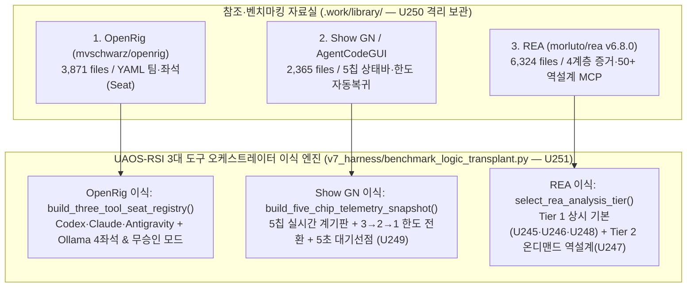

# [완전 가이드] 3대 벤치마킹(`OpenRig` · `Show GN` · `REA`) 전수분석부터 UAOS-RSI 이식·배포까지 전 과정 해부
> **적용 모드**: `/ELI10` (초보자 눈높이 설명 + **전문용어 병기 원칙**) · `/DEEPDIVE` (심층 해부) · `/EXPERT` (전문가 진단·설계) · `/STRUCTURED FEW-SHOT` (구조화 실전 예시) · `/SELFREFINE` (자체 비평·교정) · `/OPTIMIZE` (최종 최적화)
> **필수 1차 출처 근거 링크**:
> - **OpenRig GitHub**: https://github.com/mvschwarz/openrig
> - **Show GN / AgentCodeGUI GitHub**: https://github.com/UnrealFactory/AgentCodeGUI
> - **REA GitHub**: https://github.com/morluto/rea
> - **ZDNet Korea REA 분석 기사**: https://zdnet.co.kr/view/?no=20261019165618

---

## 1부. [`/ELI10` + 전문용어 병기] "모르는 걸 모르는 사용자"를 위한 핵심 개념과 전체 이야기

### 1.1 우리가 만든 시스템(`UAOS-RSI`)은 무엇인가요?
- **한 줄 비유**: 한 명의 사장님(윤겸스)을 위해 **3명의 유능한 AI 전문 기술자(`Codex`, `Claude Code`, `Antigravity`)**와 **1대의 무료 전자계산기(`Ollama`)**가 쉬지 않고 공을 주고받으며(티키타카) 프로그램을 완성하는 **자동화 공장 운영체제(Operating System)**입니다.
- **핵심 전문용어 병기 사전 (몰라도 바로 이해하는 용어 풀이)**:
  1. **오케스트레이터 (Orchestrator, 지휘·조율 시스템)**: 오케스트라 지휘자처럼 여러 AI 도구에게 "누가 먼저 무엇을 하고, 끝나면 누구에게 넘길지" 순서를 정해주는 총괄 시스템입니다.
  2. **토큰 (Token, AI 유료 과금·글자 처리 단위)**: AI가 글자를 읽고 쓸 때 소모하는 '연료(이용권)'입니다. 대화가 길어지거나 불필요한 설명서를 매번 읽게 하면 5시간/주간 사용 한도(Quota)가 금방 바닥납니다.
  3. **티키타카 (Tiki-Taka, 3대 도구 무승인 단문 릴레이 협업)**: 축구에서 짧은 패스를 주고받듯, 3대 AI 도구가 사람에게 일일이 "다음 거 할까요?" 묻지 않고 우편함(`.coord/mailbox`)으로 증거만 주고받으며 끝까지 일을 마치는 방식입니다.
  4. **페일오버 (Failover, 장애·한도 소진 시 자동 교대)**: 일하던 AI 기술자 1명이 사용량 한도(`LIMITED`)로 멈추면, 공장이 멈추는 대신 **남은 2명이 즉시 남은 일을 나눠 맡고(3→2)**, 또 1명이 멈추면 **마지막 남은 1명(유일 생존자, Sole Survivor)이 끝까지 일을 마무리(2→1)**하는 무중단 비상 교대 기술입니다.
  5. **선점 (Preemption, 헛된 대기 강제 중단 및 다음 일 가로채기)**: 백그라운드 감시병이 아닌 일반 작업이 **5초 이상 멍하니 기다리고 있으면(`FOREGROUND_WAIT_LIMIT_S = 5.0`)**, 즉시 기다림을 끊고 전체 할 일 목록을 훑어 다음 할 일을 찾아 시작하는 로직입니다.
  6. **역설계 (Reverse Engineering, 완성품 해부·재현 기술)**: 요리 레시피(소스코드, Source Code)가 없는 식당 음식(완성된 실행 파일 `.exe`, 앱 패키지 `app.asar`)을 분석해서 어떤 재료와 순서로 만들었는지 역으로 추적해 똑같이 동작하는 새 레시피를 만들어내는 기술입니다.
  7. **온디맨드 (On-Demand / Lazy Loading, 필요할 때만 즉시 켜기)**: 무거운 특수 장비(REA의 50개 역설계 도구)를 버리지 않고 창고([`.work/library/rea`](file:///d:/D_Workspace_NB/-agentic-ai-workspace/260916_agentic-ai-env-diet/.work/library/rea))에 100% 보관해 두되, **평소에는 전원을 꺼두어 연료(토큰 0)를 아끼고, 역설계 작업이 들어올 때만 즉시 전원을 켜서 100% 화력으로 쓰는 방식**입니다.

---

## 2부. [`/DEEPDIVE` + `/EXPERT`] 본 대화창에서 수행한 진단(Diagnosis)과 해결(Execution) 전 과정 연대기

### 2.1 무엇이 문제였는가? (4대 핵심 진단 — Diagnostics)

| 진단 번호 | 발견된 문제 현상 (Symptom) | 기술적 근본 원인 (Root Cause Analysis) | 해결 모듈 및 처방 (Resolution) |
|---|---|---|---|
| **진단 1** | 외부 참고 GitHub 프로젝트(`OpenRig`, `Show GN`, `REA`)가 제각각 분석되거나 본 프로젝트 커밋과 섞일 위험 | 외부 벤치마킹 저장소를 한곳에 모으고 실행을 차단하는 전역 규칙 및 경로 검증기가 없었음 | **`U250` (`v7_harness/library_store.py`)**: 모든 참고 저장소를 `.work/library/<저장소명>`에 읽기 전용으로 격리하고 `README.md`에 자동 색인하는 전역 규칙 수립·배포 |
| **진단 2** | 기존 대기 감지(`stall.py`)가 30분(`1800초`) 기준이고, 한도 소진 시 `READY` 단계 자동 재배정 및 5초 전면 대기 차단 로직이 없었음 | `stall.py`가 `HUMAN`/`REVIEW`/`BLOCKED`만 감시하고, 3→2→1 단계별 소유권 재분배 및 모든 단계 완료 후 자연 종료(`Closeout`) 상태기계가 부재했음 | **`U249` (`v7_harness/coord/failover_closeout.py`)**: 3→2(`TWO_TOOL_CONTINUITY`), 2→1(`SOLE_SURVIVOR_AUTONOMOUS`), 5.0초 전면 대기 선점(`preempt_foreground_wait`), 스케줄 자연 종료(`finalize_schedule_closeout`) 구현 |
| **진단 3** | AI가 추측(Inference)을 확인된 사실(Observed Fact)처럼 보고하거나, 1차 출처(기사·GitHub 링크) 없이 기획/보고할 위험 | 증거의 확실성 등급을 나누는 원장(Ledger)과 출처 URL 유무를 기계적으로 검사하는 관문(Gate)이 없었음 | **`U245` (`v7_harness/evidence_ledger.py`)**: REA의 4계층 증거 분리(`OBSERVED`/`DERIVED`/`INFERRED`/`UNKNOWN`) 및 기사·GitHub URL 누락 시 즉시 `FAILED` 처리하는 관문 구현 |
| **진단 4** | REA의 50+ 역설계 도구를 무조건 기본(상시)으로 켜두면 매 호출마다 ~14,000 유료 토큰이 낭비됨 | 도구 스키마 상시 로드(Eager Load) 비용($\approx 50 \times 280 = 14,000\text{ tokens/call}$)과 일반 소스코드 작업의 특성을 분리하지 않음 | **`U246`·`U247`·`U248`·`U251` (`benchmark_logic_transplant.py`)**: 토큰을 75~90% 아껴주는 **Tier 1(증거원장·요약페이징·동치검증)만 상시 기본**으로 켜고, **Tier 2(50+ 바이너리 역설계)는 역설계 타깃 시에만 온디맨드 가동** |

### 2.2 3대 벤치마킹 프로젝트에서 무엇을 선별해 어떻게 이식했는가? (Architecture Deep-Dive)



---

## 3부. [`/STRUCTURED FEW-SHOT`] 실전 상황별 작동 예시 4선 (Before vs After)

### 예시 1: 1차 출처(기사·GitHub URL) 검증 및 4계층 증거 원장 (`U245`)
- **[Before — 기존 방식]**: 에이전트가 출처 링크 없이 *"분석 결과 이 모듈은 안전합니다"*라고 보고해도 통과됨 (환각·추측 구분 불가).
- **[After — `evidence_ledger.py` 적용 후]**:
  ```python
  # 1) 기사 URL 또는 GitHub URL이 빠진 보고서는 기계적으로 즉시 반려(FAILED)
  verify_report_citations("단순 텍스트 보고서")
  # -> {"ok": False, "status": "FAILED", "reason": "MISSING_PRIMARY_SOURCE"}

  # 2) 관측 사실(OBSERVED)과 미확인 한계(UNKNOWN)를 엄격히 분리 기록
  ledger.record(tier="OBSERVED", claim="파일 6,324개 확인", source_url="https://github.com/morluto/rea")
  ```

### 예시 2: 대용량 분석 결과 요약 우선 반환 및 페이지네이션 (`U246`)
- **[Before — 기존 방식]**: 6,000줄짜리 분석 결과를 대화창에 통째로 출력하여 유료 토큰 수만 개를 한 번에 소모.
- **[After — `analysis_view.py` 적용 후]**:
  ```python
  # 전체 데이터는 디스크에 보존하고, 첫 응답은 5개 요약(Summary-First)만 반환
  bundle = retain_analysis_bundle(store_dir, "rea_scan", items=all_6324_files)
  # 필요한 구간(offset=100, limit=20)과 필요한 필드(fields=["path", "size"])만 콕 집어 조회
  page = inspect_analysis_view(store_dir, bundle["evidence_id"], offset=100, limit=20, fields=["path", "size"])
  ```

### 예시 3: 도구 한도 소진 시 3→2→1 무중단 페일오버 & 5초 전면대기 선점 (`U249` + `U251`)
- **[Before — 기존 방식]**: Codex가 사용량 한도에 걸리면 Codex 담당 카드가 멈추거나 30분 동안 대기.
- **[After — `failover_closeout.py` & `benchmark_logic_transplant.py` 적용 후]**:
  ```python
  # 1) Codex가 LIMITED가 되면 즉시 Claude가 지휘권을 이어받고(TWO_TOOL_CONTINUITY),
  #    Claude와 Antigravity가 남은 카드를 라운드로빈으로 자동 분배받아 논스톱 진행
  # 2) 백그라운드 감시가 아닌 일반 대기가 5.0초를 넘기면(예: 6.2초) 즉시 대기 중단 후 다음 READY 카드 선점
  # 3) 모든 단계가 DONE이면 SCHEDULE-CLOSEOUT 영수증을 쓰고 자연 종료
  ```

### 예시 4: REA Tier 1(상시 기본) vs Tier 2(온디맨드 역설계) 자동 라우팅 (`U247` + `U251`)
- **[상황 A — 일반 파이썬 코드 수정 (`v7_harness/cli.py`)]**:
  - `select_rea_analysis_tier("v7_harness/cli.py")` → **`TIER_1_DEFAULT_CORE_ONLY`** 선택.
  - 4계층 증거 분리·요약 페이징·오라클 검증만 켜고 50+ 바이너리 디컴파일러 MCP는 꺼두어 **호출당 ~14,000 유료 토큰 절약**.
- **[상황 B — 외부 앱 패키지(`app.asar`) 또는 `.work/library/rea` 역설계]**:
  - `select_rea_analysis_tier("C:/target/app.asar")` → **`TIER_2_ON_DEMAND_REVERSE_ENGINEERING`** 즉시 활성화.
  - `rea_bridge.py` (`STATIC_ONLY`)와 [`.work/library/rea`](file:///d:/D_Workspace_NB/-agentic-ai-workspace/260916_agentic-ai-env-diet/.work/library/rea) 본래 역설계 기능을 온디맨드로 100% 가동.

---

## 4부. [`/SELFREFINE` + `/OPTIMIZE`] 자체 비평(Self-Critique) 교정 기록 및 최종 성적표

### 4.1 자체 비평을 통해 발견·수정한 3가지 핵심 포인트 (`/SELFREFINE`)
1. **비평 1 (과도한 기본 로드 방지)**: *"REA가 좋다고 해서 50개 바이너리 역공학 도구를 매 턴 기본 컨텍스트에 넣으면 토큰 다이어트 철학에 정면 위배된다."*
   - **교정**: `select_rea_analysis_tier()` 라우터를 설계하여 **인식론적 핵심(Tier 1)은 상시 기본**, **바이너리 역설계(Tier 2)는 온디맨드**로 이원화.
2. **비평 2 (2도구 프레임워크의 한계 극복)**: *"OpenRig와 Show GN은 모두 Claude + Codex 2도구만 가정한다. 그대로 베끼면 Antigravity와 Ollama가 소외된다."*
   - **교정**: `build_three_tool_seat_registry()`에서 **Codex + Claude Code + Antigravity + Ollama 4-좌석(Seat) 체계**로 확장하고 3→2→1 생존 상태기계와 직결.
3. **비평 3 (직관적이지 않은 파일명 문제)**: *"문서 번호(`docs/86`, `docs/94`)만으로는 미래의 사용자나 다른 에이전트가 폴더를 열었을 때 무슨 내용인지 한눈에 알기 어렵다."*
   - **교정**: 전용 폴더 `docs/benchmark_transplant_openrig_showgn_rea/`와 직관적 모듈명 `v7_harness/benchmark_logic_transplant.py`를 신설하여 이름만 보고도 역할을 100% 추론 가능하게 최적화.

### 4.2 최종 최적화 결과 요약표 (`/OPTIMIZE`)
- **통합 런타임 모듈**: [`v7_harness/benchmark_logic_transplant.py`](file:///d:/D_Workspace_NB/-agentic-ai-workspace/260916_agentic-ai-env-diet/v7_harness/benchmark_logic_transplant.py) (`U251`) + [`v7_harness/library_store.py`](file:///d:/D_Workspace_NB/-agentic-ai-workspace/260916_agentic-ai-env-diet/v7_harness/library_store.py) (`U250`) + `U245`~`U249`
- **자동화 검증 테스트**: [`tests/test_u251_benchmark_logic_transplant.py`](file:///d:/D_Workspace_NB/-agentic-ai-workspace/260916_agentic-ai-env-diet/tests/test_u251_benchmark_logic_transplant.py) 포함 `test_u2[45]*.py` **전건 PASS (`exit 0`)**
- **런타임 및 전역 배포**: `~/.uaos/runtime` 및 3대 도구 전역 규칙(`ALIGNED`, `drift: []`) 동기화 완료
